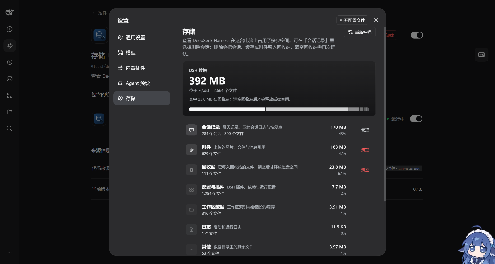

# dsh-storage · storage panel for DeepSeek Harness

> Adds a **Storage** section to DeepSeek Harness (DSH) settings: see how much
> `$DSH_HOME` takes, where it goes, and move what you no longer need to a recycle bin.



## Features

- **Overview**: total size, file count, disk used/free, plus how much is still held in the recycle bin.
- **Breakdown**: sessions, attachments, trash, config & plugins, workspace data, logs, other —
  size, file count and share for each.
- **Session manager**: search by title or workspace; sessions in use are marked and cannot be selected;
  deleting moves the session (and its children) to the recycle bin and leaves attachments alone.
- **Cleanup**: cache and attachments move to the recycle bin; emptying the bin is permanent and
  requires an explicit acknowledgement.
- **Fully local**: no network requests, reads only `$DSH_HOME`.

## Install

Needs DSH with bundle plugin support (0.2+). Put this directory anywhere, then either:

```text
# from a DSH session (recommended)
plugin_manager { action: "install_bundle", target: "<absolute path to this directory>" }

# or with the CLI
dsh plugin --profile <profile> add link:<absolute path to this directory>
```

Refresh the page and open **Settings → Storage**.

Uninstall with `remove_bundle` (or remove the dependency from your profile);
the recycle bin at `$DSH_HOME/dsh-storage-trash` has to be removed by hand.

## Safety

Cleanup is the only write path, so it is gated twice and validated on every file:

- loopback-only requests, with a loopback `Host` header;
- `Origin` / `Sec-Fetch-Site` checks on POST;
- one-time 48-char `cleanupToken` (compared with `timingSafeEqual`);
- POST + `application/json` only — GET is always read-only;
- two-phase plan → execute, plans expire after 120 s;
- every path re-checked with `relative()` before it is touched;
- symlinks are skipped, never deleted through;
- attachments must keep size and mtime between plan and execute;
- sessions that are in use are refused (409 `sessions-active`);
- files are renamed into the recycle bin first; permanent deletion needs an acknowledgement.

## Configuration (optional)

```yaml
- insert:
    - id: dsh-storage
      name: dsh-storage
      config:
        scanBudgetMs: 8000    # per-scan budget, 1000–60000
        cacheTtlMs: 60000     # stats cache TTL, 0–600000
```

## Development

Plain JavaScript, no build step:

```powershell
node --check index.js      # rename to .mjs first for ESM
node --check client.js
```

`index.js` also exports `resolveDshHome()` and `collectStorageStats()` for tests outside the harness.

## License

MIT
