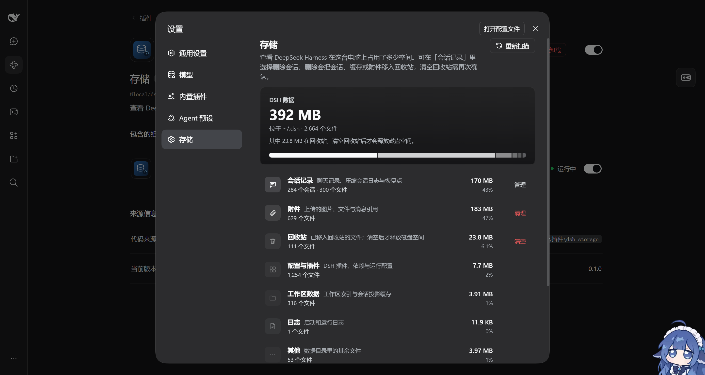

# dsh-storage · DSH 存储面板

> 给 [DeepSeek Harness](https://github.com/deepseek-ai)（DSH）设置页加一个「存储」面板：
> 看清 `$DSH_HOME` 到底占了多少空间、都花在哪，并把该清的清进回收站。



## 功能

- **总览**：DSH 数据总量、文件数、磁盘已用/可用；单独标出回收站里还压着多少。
- **分类明细**：会话记录 / 附件 / 回收站 / 配置与插件 / 工作区数据 / 日志 / 其他，
  每类给出大小、文件数、占比。
- **会话管理**：按标题或工作区搜索；运行中的会话标记「使用中」且不可选；
  删除会把会话（含子会话）移入回收站，附件不跟着删。
- **清理**：缓存、附件移入回收站；清空回收站是永久删除，必须勾选确认。
- **纯本地**：零网络请求，只读 `$DSH_HOME`。

## 安装

前置：已安装 DeepSeek Harness；插件以 profile 为单位安装，下面以 `web` 为例。

### 方式一：从 npm 安装（推荐）

```powershell
dsh plugin --profile web add dsh-storage
```

### 方式二：本地目录 / 会话内安装

```text
# 在 DSH 会话里
plugin_manager { action: "install_bundle", target: "<本目录绝对路径>" }

# 或走 CLI
dsh plugin --profile web add link:<本目录绝对路径>
```

装完刷新页面：**设置 → 存储**。

卸载：`dsh plugin --profile web remove dsh-storage`（或在插件页卸载）。
回收站目录 `$DSH_HOME/dsh-storage-trash` 需要自己手动删。

## 安全设计

清理是这个插件唯一会写盘的地方，所以做成了两阶段 + 多重闸门：

| 闸门 | 行为 |
|---|---|
| 回环限定 | 非 `127.0.0.1/::1` 请求直接 403；`Host` 头也必须是回环名 |
| 同源校验 | POST 校验 `Origin` 与 `Sec-Fetch-Site`，挡 CSRF |
| 一次性令牌 | 读接口下发 48 位 `cleanupToken`，写请求必须带上（`timingSafeEqual` 比较） |
| 只认 POST | 一切修改都是 POST + `Content-Type: application/json`；GET 永远只读 |
| 两阶段计划 | 先 `plan` 拿到文件清单/体积（120 秒过期），再凭 `planId` 执行 |
| 路径包含校验 | 执行时逐个文件重算 `relative()`，越出根目录的一律跳过 |
| 不跟符号链接 | 扫描与执行都 `lstat`，符号链接从不进入删除范围 |
| 附件时间戳 | 附件要求 size + mtime 与计划时一致，防止计划后文件被改 |
| 运行中会话拒绝 | 服务层 409 `sessions-active`，UI 层勾选框禁用 |
| 可恢复 | 先 `rename` 进回收站；跨盘才回退为复制+删除；永久删除需勾选确认 |

## 配置（可选）

在 `cordis.patch.yml` 的行上加 `config`：

```yaml
- insert:
    - id: dsh-storage
      name: dsh-storage
      config:
        scanBudgetMs: 8000    # 单次扫描预算，1000–60000
        cacheTtlMs: 60000     # 统计缓存时长，0–600000
```

## 开发

纯 JS，无构建步骤：

```powershell
node --check index.js      # ESM 需先改名 .mjs 再 check
node --check client.js
```

`index.js` 额外导出 `resolveDshHome()` 与 `collectStorageStats()`，便于脱离宿主单测。

## 许可

MIT
